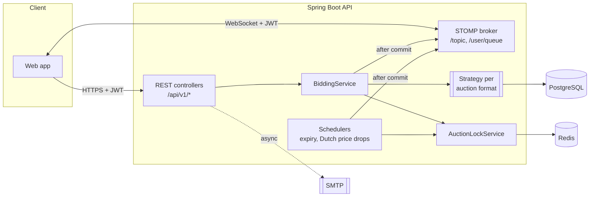

# BidOu: a real-time auction platform

> **TODO (you):** one-line pitch + a hero screenshot or GIF, e.g.
> ``

BidOu is a real-time online auction platform supporting four auction formats
(**Proxy, Dutch, Vickrey and Candle**) with live bid updates over WebSocket,
distributed locking so concurrent bids never corrupt an auction, and an admin
back office with MFA, an audit log, KYC review and dispute handling.

This repository is a **technical case study**. The full application is
private; this repo contains:

- a written walkthrough of the architecture and the hardest problems
- [`bidding-engine/`](bidding-engine): the auction rules and concurrency
  model, extracted into a small, dependency-free Java 21 module that you can
  run with `mvn test`

The complete source is available to review on request, or in a live walkthrough.

---

## At a glance

| | |
|---|---|
| **Backend** | Java 21, Spring Boot 3.2, Spring Security, Spring Data JPA, STOMP over WebSocket |
| **Data** | PostgreSQL (JSONB for per-format settings), Redis (Redisson distributed locks) |
| **Frontend** | **TODO (you):** framework, state management, WebSocket client |
| **Auth** | Stateless JWT, BCrypt, TOTP two-factor for admins, email verification |
| **Ops** | Docker Compose, Spring Actuator + Prometheus metrics |
| **Testing** | JUnit 5, Mockito, Testcontainers (real Postgres + Redis) |
| **Size** | ~6,500 lines of backend Java, 40 REST endpoints across 7 controllers |

## Architecture



More detail: [docs/architecture.md](docs/architecture.md).

## Four auction formats, one engine

Each format is a `BiddingStrategy` (Strategy pattern) picked by the auction's type:

| Format | How it works | Interesting part |
|---|---|---|
| **Proxy** | Bidders set a maximum; the system bids for them one increment at a time | Auto-bid resolution, reserve jump, anti-sniping "popcorn" extension |
| **Dutch** | Price drops on a schedule; first to accept wins | Price drop and purchase must never interleave |
| **Vickrey** | Sealed bids; highest bidder pays the *second-highest* price | Hiding the leader during the auction; settlement at close |
| **Candle** | Proxy bidding, but the auction ends at a hidden random moment | Defeats sniping without extensions that would leak the end time |

Rules, worked examples and edge cases: [docs/auction-types.md](docs/auction-types.md).

## The hard problem: concurrent bids

Popular auctions get many bids in the same second, sometimes on more than one
server. Each bid reads the current price, decides the outcome and writes it
back, so two bids interleaving would corrupt the auction.

Bids for the same auction are serialised with a Redis lock, and the order of
operations matters:

```
lock → begin transaction → apply bid → COMMIT → broadcast → unlock
```

An earlier version released the lock *before* the commit. I found this,
reproduced it with a Testcontainers test firing 40 simultaneous bids at real
Postgres and Redis (it crashed with optimistic-lock failures that surfaced as
HTTP 500s), then fixed it and extended the same lock to the background jobs.

The full write-up, with diagrams and before/after code: [docs/concurrency.md](docs/concurrency.md).

## Security

Stateless JWT authentication for both REST and the WebSocket handshake,
BCrypt password hashing, role-based access (`BIDDER`, `SELLER`, `SUPPORT_ADMIN`,
`SUPER_ADMIN`), TOTP two-factor authentication for admins, email verification,
and an append-only audit log of admin actions. See [docs/security.md](docs/security.md).

## Run the bidding engine

```bash
cd bidding-engine
mvn test        # Java 21+, no Docker or database needed
```

39 tests: the rules of all four formats, plus concurrency tests that release 40
threads against one auction and check it stays consistent.

## Screenshots

> **TODO (you):** add images to [`docs/screenshots/`](docs/screenshots) and reference them here.
> Suggested: auction list, live bidding with outbid toast, Dutch countdown,
> Vickrey sealed-bid confirmation, admin dashboard, MFA setup.

## What I'd do next

- Replace Hibernate `ddl-auto=update` with Flyway migrations
- Load-test bidding with Gatling to find the lock's throughput ceiling per auction
- Move WebSocket fan-out to a Redis-backed broker so it scales past one instance
- Let the current leader raise their own maximum (common on proxy auction sites)

## About

**TODO (you):** your name, role you're looking for, LinkedIn / email.
