# BidOu: a real-time auction platform

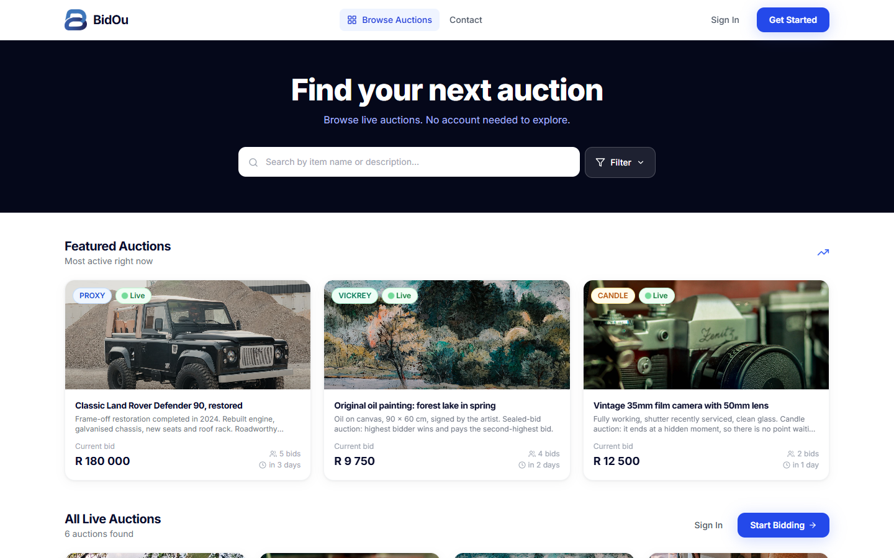

BidOu is a real-time online auction platform supporting four auction formats
(**Proxy, Dutch, Vickrey and Candle**) with live bid updates over WebSocket,
distributed locking so concurrent bids never corrupt an auction, and an admin
back office with MFA, an audit log, KYC review and dispute handling.

This repository is a **technical case study**. The full application is
private; this repo contains:

- a written walkthrough of the architecture and the hardest problems
- [`bidding-engine/`](bidding-engine): the auction rules and concurrency
  model, extracted into a small, dependency-free Java 21 module that you can
  run with `mvn test`

The complete source is available to review on request, or in a live
walkthrough; see [About](#about) for how to reach me.

---

## At a glance

| | |
|---|---|
| **Backend** | Java 21, Spring Boot 4.1, Spring Security 7, Spring Data JPA (Hibernate 7), STOMP over WebSocket |
| **Data** | PostgreSQL (JSONB for per-format settings), Redis (Redisson distributed locks) |
| **Frontend** | React 18, Vite, Tailwind CSS, TanStack Query, Zustand, React Hook Form + Zod, Framer Motion, STOMP over SockJS |
| **Auth** | Stateless JWT, BCrypt, TOTP two-factor for admins, email verification |
| **Ops** | Docker Compose, Spring Actuator + Prometheus metrics |
| **Testing** | JUnit 5, Mockito, Testcontainers (real Postgres + Redis) |
| **Size** | ~6,500 lines of backend Java, 40 REST endpoints across 7 controllers |

## Architecture

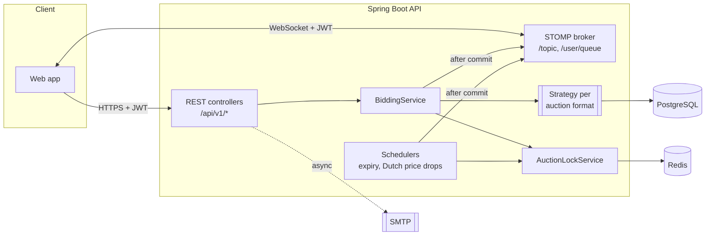

More detail: [docs/architecture.md](docs/architecture.md).

## Four auction formats, one engine

Each format is a `BiddingStrategy` (Strategy pattern) picked by the auction's type:

| Format | How it works | Interesting part |
|---|---|---|
| **Proxy** | Bidders set a maximum; the system bids for them one increment at a time | Auto-bid resolution, reserve jump, anti-sniping "popcorn" extension |
| **Dutch** | Price drops on a schedule; first to accept wins | Price drop and purchase must never interleave |
| **Vickrey** | Sealed bids; highest bidder pays the *second-highest* price | Hiding the leader during the auction; settlement at close |
| **Candle** | Proxy bidding, but the auction ends at a hidden random moment | Defeats sniping without extensions that would leak the end time |

Rules, worked examples and edge cases: [docs/auction-types.md](docs/auction-types.md).

## The hard problem: concurrent bids

Popular auctions get many bids in the same second, sometimes on more than one
server. Each bid reads the current price, decides the outcome and writes it
back, so two bids interleaving would corrupt the auction.

Bids for the same auction are serialised with a Redis lock, and the order of
operations matters:

```
lock → begin transaction → apply bid → COMMIT → broadcast → unlock
```

An earlier version released the lock *before* the commit. I found this,
reproduced it with a Testcontainers test firing 40 simultaneous bids at real
Postgres and Redis (it crashed with optimistic-lock failures that surfaced as
HTTP 500s), then fixed it and extended the same lock to the background jobs.

The full write-up, with diagrams and before/after code: [docs/concurrency.md](docs/concurrency.md).

## Security

Stateless JWT authentication for both REST and the WebSocket handshake,
BCrypt password hashing, role-based access (`BIDDER`, `SELLER`, `SUPPORT_ADMIN`,
`SUPER_ADMIN`), TOTP two-factor authentication for admins, email verification,
and an append-only audit log of admin actions. See [docs/security.md](docs/security.md).

## Run the bidding engine

```bash
cd bidding-engine
mvn test        # Java 21+, no Docker or database needed
```

39 tests: the rules of all four formats, plus concurrency tests that release 40
threads against one auction and check it stays consistent.

## Screenshots

All data is fictional demo data, created through the real API by a seeding
script (register → create → admin approval → bids), so every price and bid
history below came from the bidding engine.

**Proxy auction: a bidding war settled by automatic bids.** Aisha's max of
R195k beat Lerato's R175k, and the price jumped straight to the R180k reserve.

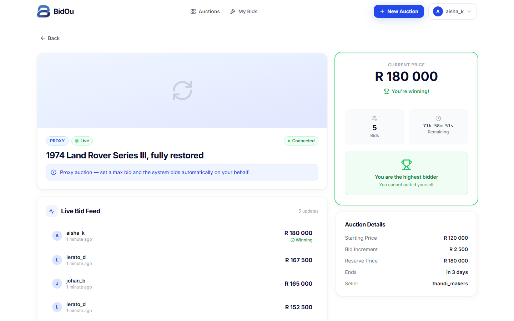

| Dutch: price drops R250 every 30 s | Vickrey: sealed bid, second price |
|---|---|
| 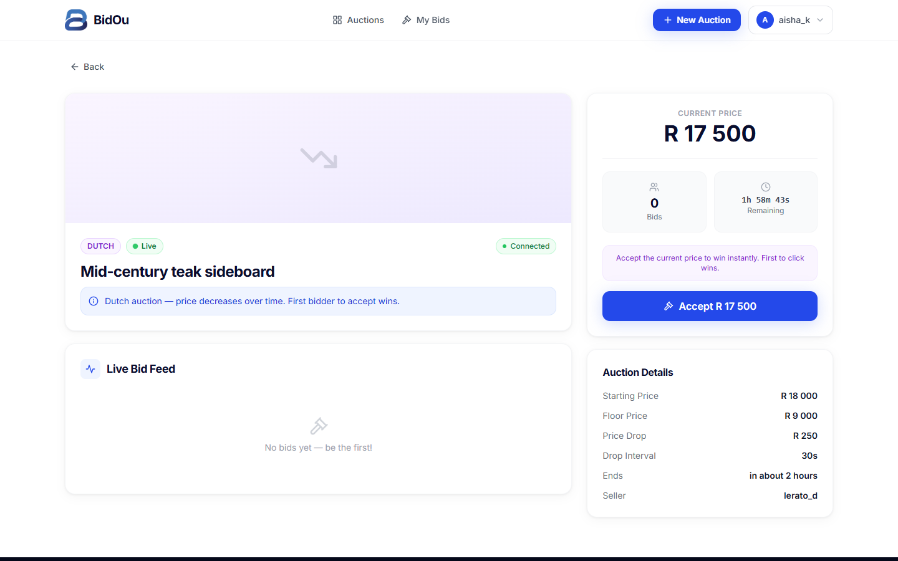 | 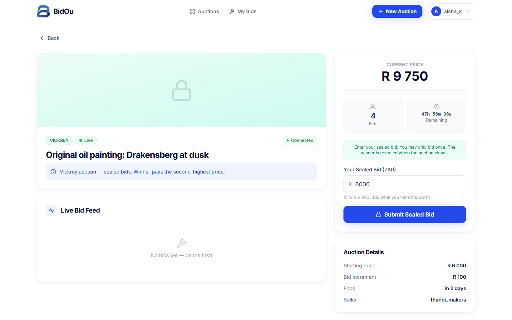 |
| **Candle: hidden end time** | **Admin console: review queue** |
| 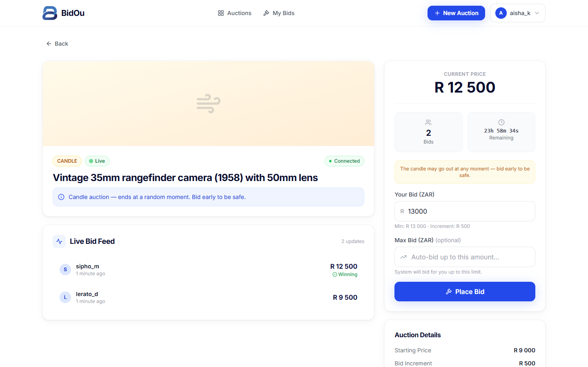 | 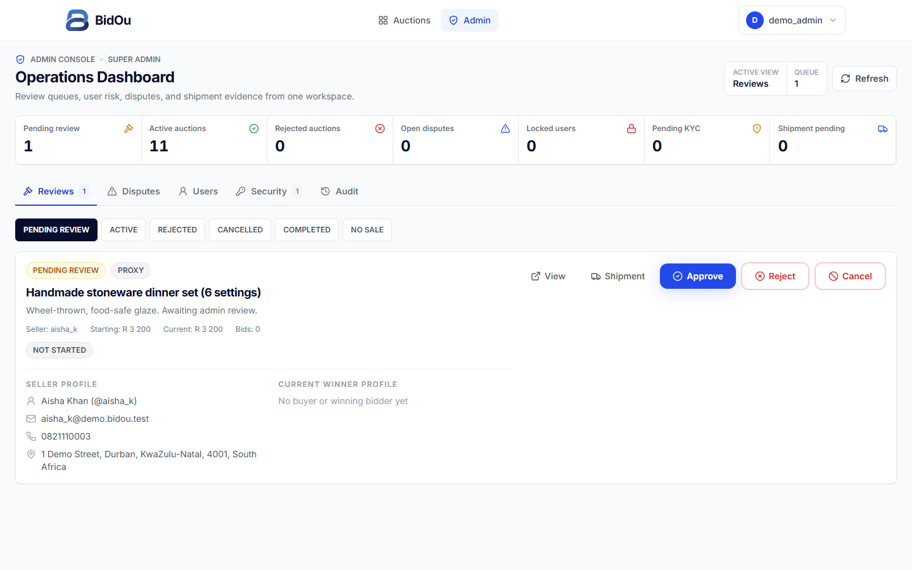 |
| **My bids** | **Create an auction** |
| 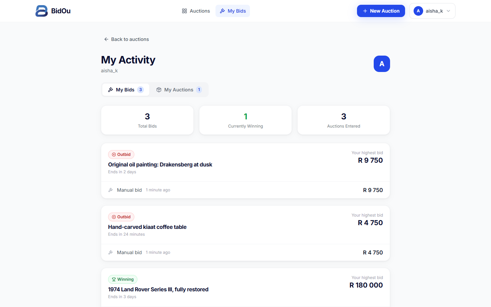 | 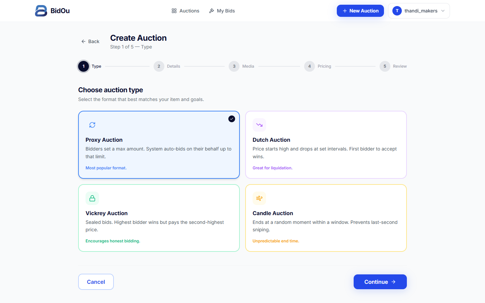 |

<p>
  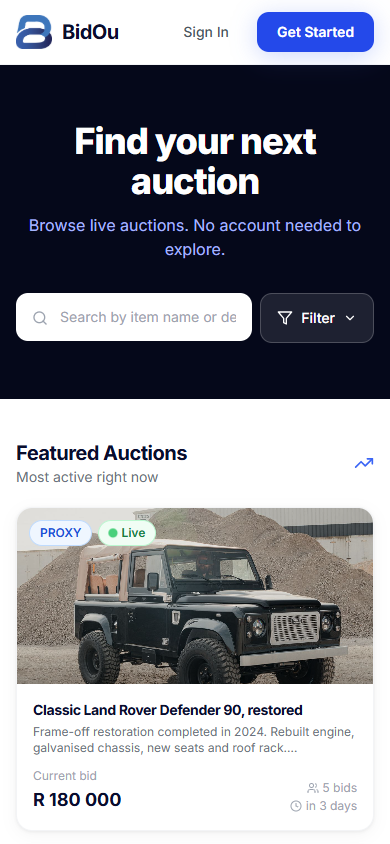
  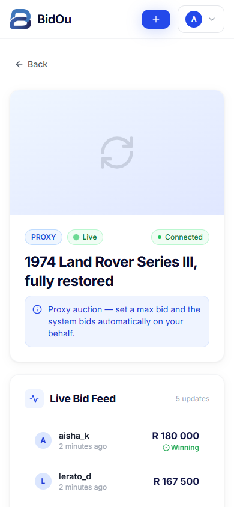
</p>

## Keeping it patched

In November 2026 I upgraded the platform from Spring Boot 3.2 to 4.1, after
the 3.x line stopped receiving free security fixes. Scanning the runtime
dependencies against [OSV.dev](https://osv.dev) took known advisories from
**123 (13 critical) to 0**. At the same time I pinned the Java runtime to
21.0.13.1, the first release that fixes
[CVE-2026-114938 ("Java4Shell")](https://nvd.nist.gov/vuln/detail/CVE-2026-114938),
a heap out-of-bounds write in the JIT-compiled Base64 decoder. That bug is
reachable on any service that decodes attacker-supplied Base64, such as
bearer tokens. The concurrency tests above guarded the upgrade, and the
app was then checked end to end.

## Roadmap

Known limitations, and why each one is next:

- **Versioned schema migrations (Flyway).** The schema is still managed by
  Hibernate's `ddl-auto=update`, plus a set of hand-written `ALTER TABLE`
  statements that run at startup. That was fine while the data model was
  changing daily, but it can't rename or drop safely and leaves no history.
  Flyway makes every schema change a reviewed, versioned file.
- **Load testing (Gatling).** The concurrency tests prove bids stay *correct*
  under contention. They don't say how many bids per second one auction can
  take, because the per-auction lock deliberately serialises them. A load
  test would measure that ceiling, so it's known before a busy auction finds it.
- **A shared WebSocket broker (Redis).** Bids are already safe across several
  server instances, because the lock lives in Redis. Live updates aren't:
  the in-memory STOMP broker only reaches users connected to the same
  instance. Relaying through Redis fixes that. Together with moving uploaded
  photos from local disk to shared storage, it's what stands between the app
  and running more than one instance.
- **Let the leader raise their own maximum.** Today the current leader is
  blocked from bidding again, which keeps the proxy logic simple. Most proxy
  auction sites allow it. Doing it right means raising the hidden maximum
  without placing a visible bid against yourself.

## About

Built by **Ipfani Obedience Muleya**, founder of BidOu. I'm looking for a
**full-stack engineer** role: I designed and built BidOu end to end, from the
React frontend to the Spring Boot backend, the concurrency model and the
Docker setup.

- GitHub: [github.com/IpfaniMuleya](https://github.com/IpfaniMuleya)
- LinkedIn: [linkedin.com/in/ipfanimuleya](https://www.linkedin.com/in/ipfanimuleya/)

For a live walkthrough or to review the full source, message me on LinkedIn.
