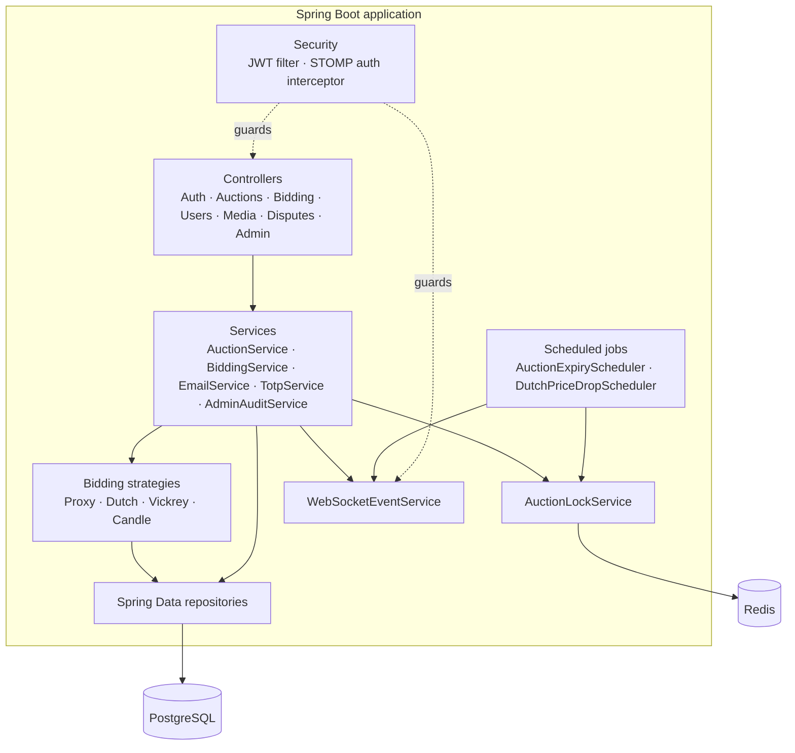
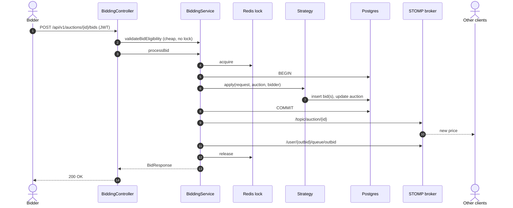
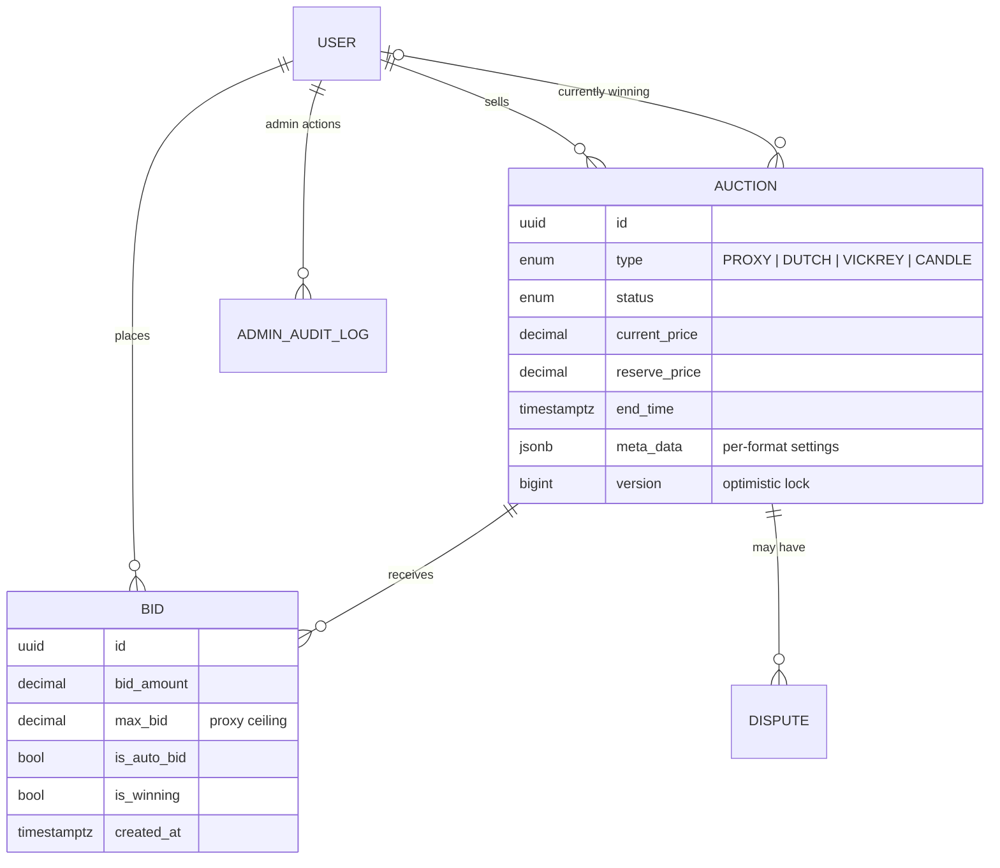

# Architecture

## Components

Packages are layered: `controller → service → strategy → repository → domain`.
Controllers handle HTTP and validation only, and services own transactions.

## Placing a bid

The cheap eligibility check (is it active, are you the seller, are you already
leading?) runs *before* the lock, so obviously invalid bids never queue on
Redis. The strategy checks again under the lock, because state can change in
between.

## Real-time updates

STOMP over WebSocket, authenticated with the same JWT on `CONNECT`:

| Destination | Payload | Who |
|---|---|---|
| `/topic/auction/{id}` | bid accepted / price update | everyone watching |
| `/topic/auction/{id}/end` | winner and final price | everyone watching |
| `/user/{name}/queue/outbid` | you've been outbid | the previous leader only |

For Vickrey auctions the topic message is stripped of the amount and the bidder.

## Data model

Design notes:

- **JSONB `meta_data`** holds per-format settings (extension window, hidden end
  time, drop rate, floor). New formats need no migration, at the cost of weaker
  typing in the database.
- **`@Version` on auctions and bids** stays as a safety net under the
  distributed lock.
- **Money is `NUMERIC(19,2)` / `BigDecimal` throughout:** no floating point.

## Beyond bidding

The private codebase also includes:

- **Auction lifecycle:** draft → admin review → active → completed / no sale / cancelled (with reason codes)
- **Fulfilment:** shipment status, carrier and tracking, evidence uploads
- **Disputes:** opened by buyers, resolved by support admins
- **KYC:** document reference, review notes, status workflow
- **Media:** image uploads with type and size limits (max 6 per auction)
- **Email:** async verification and notification emails on a bounded thread pool

## Frontend

React 18 single-page app built with Vite and styled with Tailwind CSS.

| Concern | Choice |
|---|---|
| Server state | TanStack Query (caching, refetch on focus) |
| Auth/session state | Zustand, persisted to `sessionStorage` (cleared when the tab closes) |
| Forms | React Hook Form + Zod schemas |
| HTTP | Axios with a JWT interceptor; a 401 clears the session |
| Live updates | `webstomp-client` over SockJS, subscribed per auction page |
| Motion | Framer Motion |

Routes are split into public pages (browse, auction detail, legal, contact),
signed-in pages (my bids, create auction, profile) and the admin console. The
auction page subscribes to `/topic/auction/{id}` while open and shows a
"Connected" badge for the socket state.

### Live updates: fast, then correct

When a bid message arrives, the auction page updates the price, bid count
and end time straight from the message, so the change is instant. It then
invalidates its TanStack Query cache, so the page re-fetches the auction
from the REST API. The socket message gives speed and the server gives the
final word, for example on who is currently winning. If a message is
dropped, or two arrive out of order, the next re-fetch corrects the page.

The bid feed de-duplicates by bid ID, because the same bid can arrive both
over the socket and in the re-fetch, and it keeps the latest 20 entries. On
Vickrey auctions the feed stays empty on purpose: sealed bids never reach
other browsers.

### No optimistic bids

Placing a bid deliberately does **not** update the UI before the server
answers. With proxy bidding the result depends on other people's hidden
maximums: a bid can be instantly outbid by someone's automatic counter-bid.
Showing "You're winning!" and then taking it back would be worse than a
single round trip, so the page waits for the server's verdict.

### One connection, self-healing

- A single shared STOMP client is used by every page. A guard flag stops a
  second connection from opening while one is mid-handshake, which matters
  because React 18's StrictMode mounts components twice in development.
- If the connection drops, it retries every 3 seconds, and the auction page
  shows the socket state as a "Connected" badge.
- Each page subscribes when it opens and unsubscribes when it closes, so
  moving between auctions doesn't leak subscriptions.
- An HTTP 401 from the API clears the session and sends the user to the
  sign-in page, so an expired token never leaves the UI half signed in.
