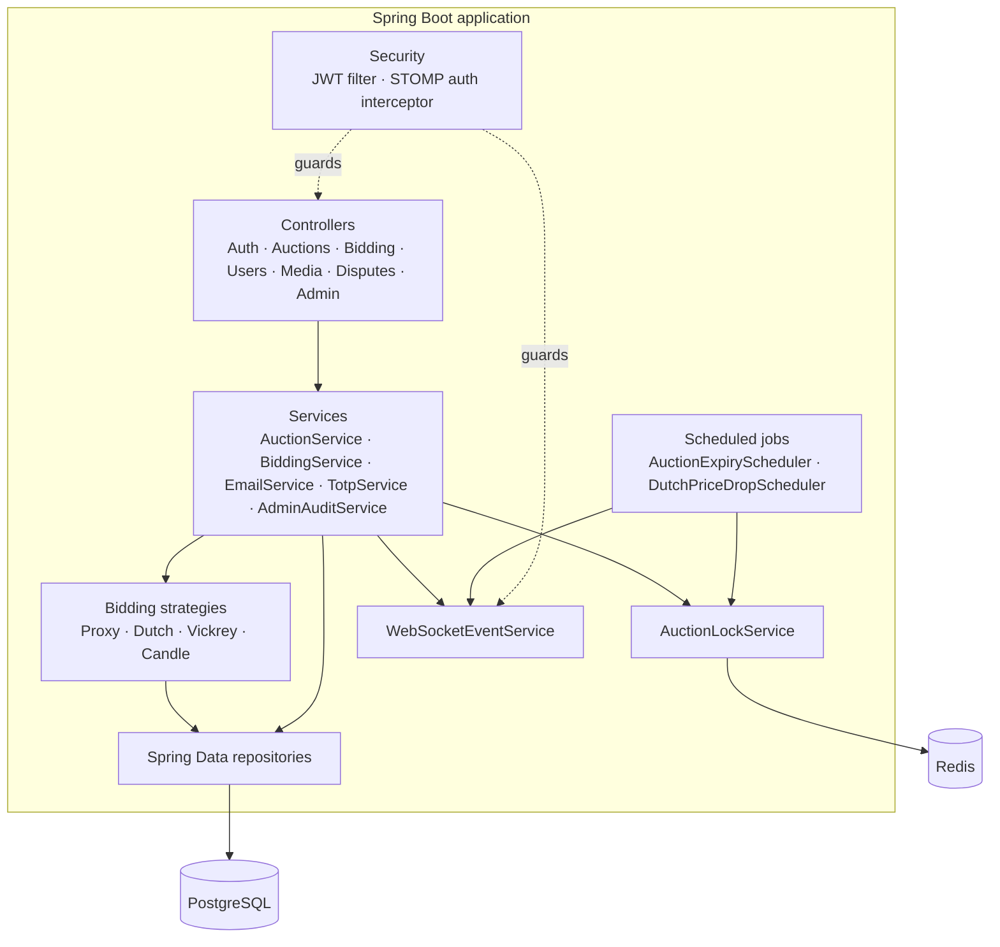
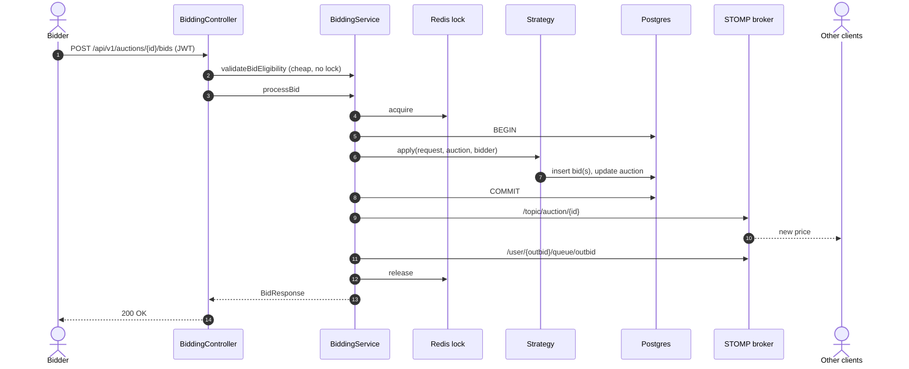
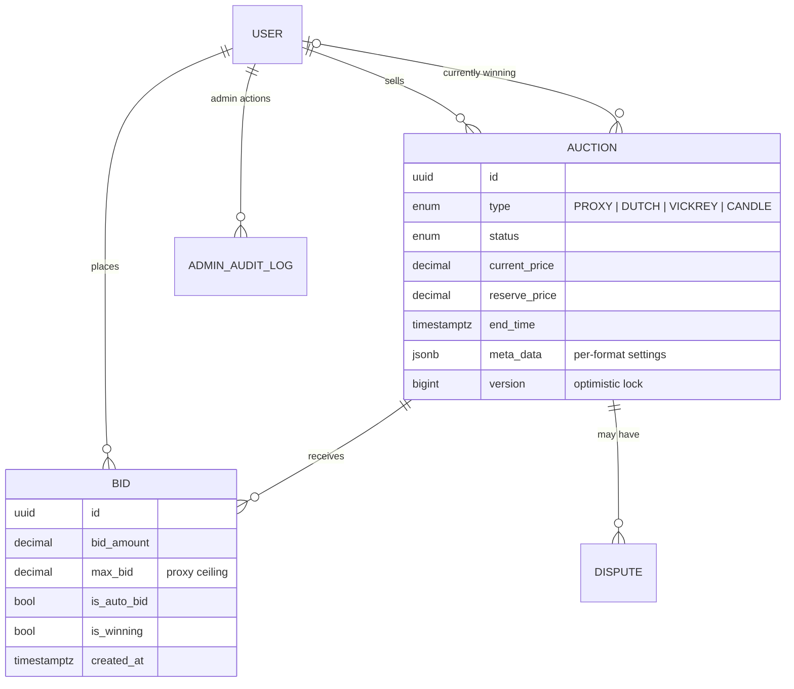

# Architecture

## Components

Packages are layered: `controller → service → strategy → repository → domain`.
Controllers handle HTTP and validation only, and services own transactions.

## Placing a bid

The cheap eligibility check (is it active, are you the seller, are you already
leading?) runs *before* the lock, so obviously invalid bids never queue on
Redis. The strategy checks again under the lock, because state can change in
between.

## Real-time updates

STOMP over WebSocket, authenticated with the same JWT on `CONNECT`:

| Destination | Payload | Who |
|---|---|---|
| `/topic/auction/{id}` | bid accepted / price update | everyone watching |
| `/topic/auction/{id}/end` | winner and final price | everyone watching |
| `/user/{name}/queue/outbid` | you've been outbid | the previous leader only |

For Vickrey auctions the topic message is stripped of the amount and the bidder.

## Data model

Design notes:

- **JSONB `meta_data`** holds per-format settings (extension window, hidden end
  time, drop rate, floor). New formats need no migration, at the cost of weaker
  typing in the database.
- **`@Version` on auctions and bids** stays as a safety net under the
  distributed lock.
- **Money is `NUMERIC(19,2)` / `BigDecimal` throughout:** no floating point.

## Beyond bidding

The private codebase also includes:

- **Auction lifecycle:** draft → admin review → active → completed / no sale / cancelled (with reason codes)
- **Fulfilment:** shipment status, carrier and tracking, evidence uploads
- **Disputes:** opened by buyers, resolved by support admins
- **KYC:** document reference, review notes, status workflow
- **Media:** image uploads with type and size limits (max 6 per auction)
- **Email:** async verification and notification emails on a bounded thread pool

**TODO (you):** add a short section on the frontend: structure, how it consumes
the WebSocket topics, and any state-management decisions.
