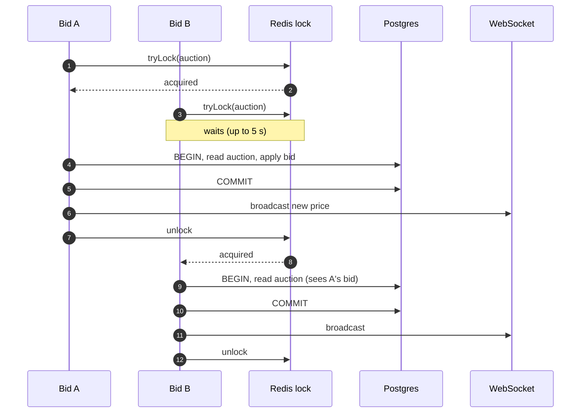
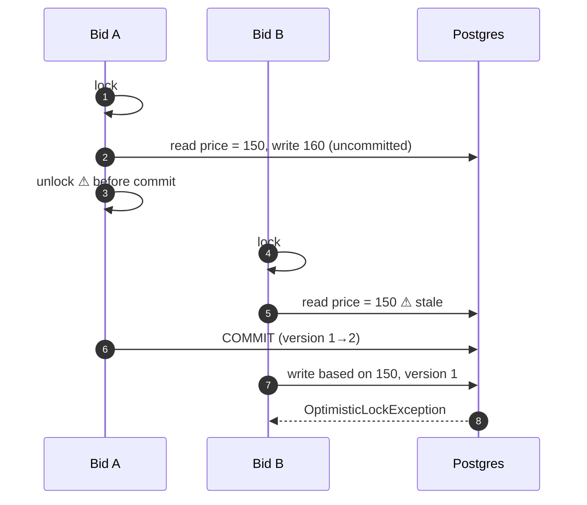

# Concurrency: keeping auctions consistent under load

## The problem

A bid is a read-modify-write: read the current price and leader, decide who
wins, write the new state. If two bids for the same auction interleave, both
can read the same "before" state, and one bid silently overwrites the other.

Bids are not the only writers. Two background jobs also change auctions:

- **Expiry** closes auctions whose time is up (every 30 s)
- **Dutch price drop** lowers Dutch prices on a schedule (every 10 s)

The app may run as several instances, so a JVM lock (`synchronized`) is not enough.

## The design

Every write to an auction goes through one per-auction lock in Redis
(Redisson `RLock`, key `auction:bid:lock:{auctionId}`):



Three rules make it work:

1. **The transaction lives entirely inside the lock.** The next holder must
   see committed data.
2. **Broadcast after commit, before unlock.** Clients never see a price that
   later rolls back, and they receive updates in bid order.
3. **Background jobs take the same lock** and re-read the auction once they
   hold it, because the state may have changed since they selected it.

The lock is taken without a fixed lease, so Redisson's watchdog renews it while
the holder is alive. A slow transaction can't outlive its lock, and a crashed
instance's lock still expires.

## The bug I found

The original `BiddingService` looked like this:

```java
@Transactional                      // ← transaction opens here
public BidResponse processBid(BidRequest request, User bidder) {
    RLock lock = redissonClient.getLock(lockKey);
    try {
        lock.tryLock(5, 10, TimeUnit.SECONDS);
        Auction auction = auctionRepository.findById(id).orElseThrow();
        BidResponse response = strategy.processBid(request, auction, bidder);
        auctionRepository.save(auction);
        return response;
    } finally {
        lock.unlock();              // ← lock released here…
    }
}                                   // ← …but COMMIT happens here, after the method returns
```

It looks correct. But Spring's `@Transactional` proxy commits *after* the method
returns, so the `finally` block releases the lock while the transaction is
still open:



`Auction` has a JPA `@Version`, so the stale write didn't corrupt data. It
failed at commit, *outside* the method's `try/catch`, and reached the user as
an HTTP 500 on a perfectly valid bid. There were two related problems:

- A rule violation thrown from a `@Transactional` strategy marked the outer
  transaction rollback-only, so the "friendly" error message also became an
  `UnexpectedRollbackException` at commit.
- The schedulers didn't lock at all. A Dutch price drop could overwrite the
  price while a buyer was accepting it.

## Reproducing it

Before fixing anything, I wrote a test that fails on the old code:

```java
@SpringBootTest
@Testcontainers
class ConcurrentBiddingIntegrationTest {
    @Container static PostgreSQLContainer postgres = new PostgreSQLContainer("postgres:16-alpine"); // Testcontainers 2
    @Container static GenericContainer<?> redis = new GenericContainer<>("redis:7-alpine").withExposedPorts(6379);

    @Test
    void simultaneousProxyBidsLeaveTheAuctionConsistent() {
        // 40 bidders, released from a CountDownLatch at the same instant
        // Assert: every response is success or a business-rule rejection,
        //         exactly one winning bid, auction agrees with it,
        //         bid counter == rows written, highest max wins.
    }
}
```

- **Before the fix:** `ObjectOptimisticLockingFailureException` on the first run.
- **After the fix:** passes consistently.

## The fix

```java
public BidResponse processBid(BidRequest request, User bidder) {      // no @Transactional
    return auctionLockService.runLocked(request.auctionId(), LOCK_WAIT, () -> {
        BidOutcome outcome = transactionTemplate.execute(tx -> applyBid(request, bidder)); // commits here
        broadcast(outcome);                                               // committed state, in order
        return outcome.response();
    }).orElseGet(() -> failure(request.auctionId(), "System is busy, please try again"));
}
```

- A new `AuctionLockService` is the single owner of the lock, used by bids
  *and* both schedulers.
- `TransactionTemplate` makes the transaction boundary explicit and nested
  inside the lock.
- The schedulers now process each auction in its own transaction. Before, one
  transaction covered the whole batch, so one failing auction rolled back the
  rest.

In this repo, [`BiddingEngine`](../bidding-engine/src/main/java/com/bidou/engine/BiddingEngine.java)
and [`AuctionSettlement`](../bidding-engine/src/main/java/com/bidou/engine/AuctionSettlement.java)
follow the same structure, and
[`ConcurrencyTest`](../bidding-engine/src/test/java/com/bidou/engine/ConcurrencyTest.java)
runs both race scenarios: concurrent proxy bids, and Dutch price drops racing buyers.

## Trade-offs

- **One lock per auction serialises its bids.** That's correct for auctions
  (order matters), and different auctions don't contend. The ceiling is
  roughly 1 / (transaction time) bids per second per auction, which is fine
  for human bidders. Load testing it is on the to-do list.
- **Redis is now on the critical path for bidding.** If Redis is down, bids fail
  fast with "busy" instead of risking inconsistent state. I chose availability
  of correct results over availability of any result.
- **Why not just optimistic locking?** `@Version` alone detects conflicts but
  turns them into retries or errors for the user. The lock avoids the conflict,
  and `@Version` remains as a safety net.
